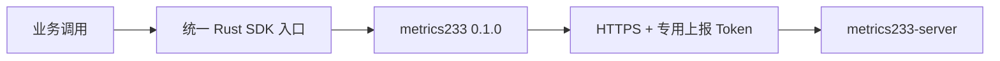

# metrics233-client-sdk-rust

Rust 客户端 SDK 的统一命名入口，固定复用已发布的 `metrics233 = 0.1.0`。它与原服务端 Rust SDK 使用同一实现，没有重复的队列、重试、HTTP 或 TLS 栈。需要 Rust 1.88+ 和 Tokio。

```sh
cargo add metrics233-client-sdk-rust@0.1.0
cargo add tokio --features rt-multi-thread,macros
```

```rust,no_run
use metrics233_client_sdk_rust::{Client, Identity};
# async fn example() -> Result<(), Box<dyn std::error::Error>> {
let metrics = Client::builder(std::env::var("METRICS233_URL")?)
    .with_token(std::env::var("METRICSPANEL_INGEST_TOKEN")?)
    .with_identity(Identity::new("1").with_service("game-api")
        .with_role("logic").with_environment("test").with_instance("node-1"))
    .with_labels([("implementation", "rust")])
    .build()?;
metrics.batch().counter("game_requests_total", 1.0)
    .gauge("game_players_online", 42.0).commit()?;
metrics.shutdown().await?;
# Ok(()) }
```

构造不读配置、不联网、不启动任务。调用方显式 `start(Duration)`、`flush().await` 和 `shutdown().await`；链式标签视图共享同一有界队列与生命周期。Counter 累加非负增量，Gauge 保留最新值。默认 1000 条生命周期序列、1000 个待发送记录、每批 500 点、4 MiB 请求体、5 秒总刷新期限；默认最多额外重试两次。完整 ACK 才出队，未确认批次保留原字节和时间戳，关闭失败可重试。



只使用专用 ingest Token，不能查询或修改监控后台。TLS 正常验证证书，拒绝重定向；本机 HTTP 仅在显式 `allow_http_loopback()` 后开放。公开游戏客户端通过业务后端中转，不分发永久管理凭据或服务端上报 Token。不要把玩家 ID、完整 IP 或请求 ID 当作高基数标签。

完整协议、容量、取消和交付语义见[原 SDK 合同](https://github.com/neko233-com/metrics-lib-rust#lifecycle-and-delivery)。`cargo test --all-targets` 和 `cargo test --doc` 验证本包，`cargo package` 验证可分发产物。原 `metrics233` 和本包 `metrics233-client-sdk-rust` 的 0.1.0 均已正式发布到 crates.io。

本包的 [crates.io 页面](https://crates.io/crates/metrics233-client-sdk-rust/0.1.0)和 [GitHub v0.1.0 发行包](https://github.com/neko233-com/metrics233-client-sdk-rust/releases/tag/v0.1.0)使用同一份已验证产物，SHA-256 为 `209401a867d0a0787e76eb36f6f481c96e24a43505743b45592ebf410b99eb2a`。Rust 1.88 单元、文档、Clippy、打包及真实服务器 Token 鉴权已有独立验证；构造和生命周期合同保持不变。
